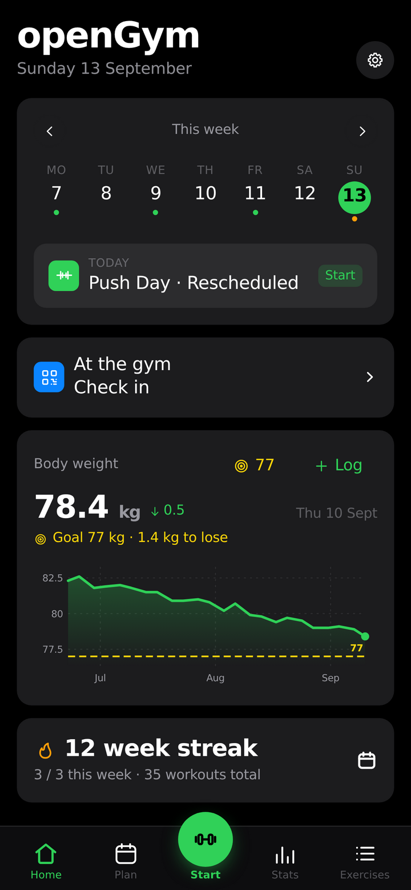
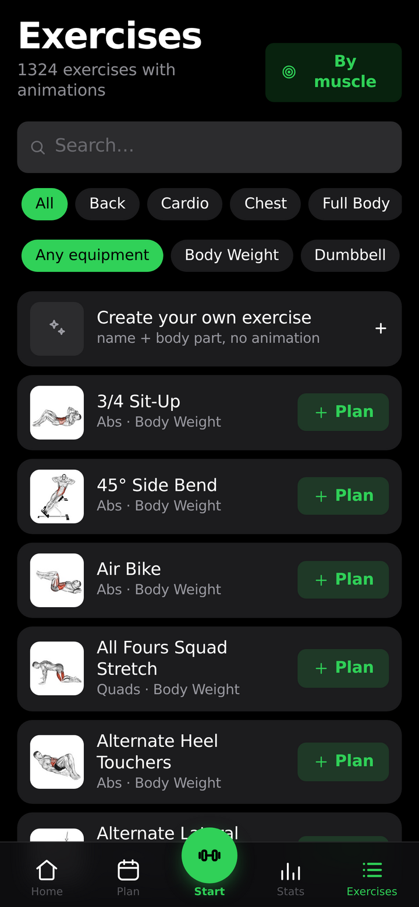
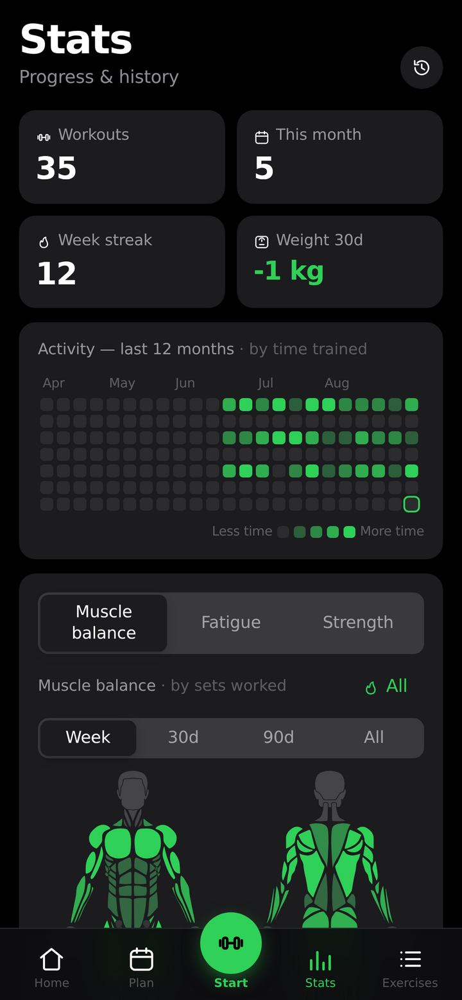

# openGym

Self-hosted gym and body-weight tracker with passkey login — packaged as a native YunoHost application.

<!-- app-description-start -->
openGym is a self-hosted gym and body-weight tracker: routines over a library of
1,300+ exercises with animated demos, guided workouts with rest timers and PR
detection, progression rules (linear, Greyskull, double progression), strength
balance ratios, body-weight charts and progress photos. Passkey (Face ID /
Touch ID / fingerprint) login, offline-capable PWA installable on the home
screen, data stored as plain files in a folder you own and back up.

This package runs openGym natively: the API as a systemd service under its own
user, the frontend as static files served by nginx — no Docker. Passkeys work
over the app's own accounts; YunoHost SSO deliberately does *not* provide the
identity (openGym has no LDAP mode), so access control on the portal side is
"who may reach the page", and accounts are created inside openGym.
<!-- app-description-end -->

## Screenshot

Home dashboard from the [official public demo](https://opengym.duarte-santos.ch/demo/):
weekly plan with scheduled workout, gym check-in, body-weight chart, and the
Home/Plan/Start/Stats/Exercises dock. Captured at 1280×720 (catalog spec).

## About notable settings

- **Exercise media** — the installer can fetch the ~350 MB exercise
  photo/animation dataset once (prompt at install). Without it the app works
  but shows exercises without pictures. The media are © GymVisual and used
  under the dataset's terms, not the app's AGPL — which is why they are not
  shipped in this repository or fetched unconditionally.
- **Accounts** — the first account registered in the app becomes admin
  (`FIRST_USER_ADMIN=1`). The YunoHost permission on the URL (default:
  `all_users`) is a reachability gate, not the app identity; signup can be
  locked to invite codes inside openGym's admin settings.
- **SSO link helper** — `scripts/contrib/opengym-sso-link.sh` optionally
  seeds an app account matching a portal user (convenience only; passkeys
  remain the app-side login).

## Update and backups

Updates bump `version` + `sources.main` (URL and sha256) together. Backups use
the standard YunoHost app backup: everything lives in `install_dir` +
`data_dir` (users, uploads, session secret, VAPID keys are all under
`data_dir` as plain files).

## Limitations / known issues

- openGym has no LDAP mode; SSO does not authenticate into the app (by
  upstream design — it rejects proxy-header identity). Portal login + separate
  app login is expected UX.
- The ~350 MB media fetch at install is from the upstream dataset host; a
  failure there does not break the install (warns and continues).

## Screenshots

## Links

- Upstream: <https://github.com/DuarteSantos8/openGym>
- Upstream self-hosting doc: <https://github.com/DuarteSantos8/openGym/blob/main/docs/SELF_HOSTING.md>
- Demo: <https://opengym.duarte-santos.ch/demo/>

## Contributing / maintainers

Packaged and maintained by [@quartztester](https://github.com/quartztester).
PRs welcome; test with a YunoHost 12 test instance before opening one.
